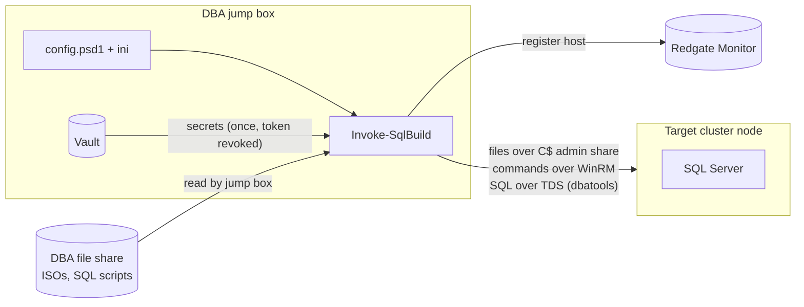

# SqlAutoInstall

[](https://github.com/mgjewett27/mgjewett27/actions/workflows/sqlautoinstall-ci.yml)

SqlAutoInstall turns a blank Windows Server cluster node into a production-ready SQL Server instance with one command:

```powershell
Invoke-SqlBuild -ComputerName sqldev01 -SqlVersion 2022
```

That one command:

- installs SQL Server from your standard ini file
- patches it to the latest CU minus one
- enables AlwaysOn (HADR), ready for the AG build
- deploys the maintenance database, backup jobs and index jobs
- grants the monitoring account its access
- disables `sa`
- registers the server in Redgate Monitor
- validates the finished build and writes a pass/fail report

It runs from a DBA **jump box** against one or more target servers. It's safe to rerun, picks up where it stopped after a failure, and supports `-WhatIf` for a dry run.

> **Version 2.0** replaces the 2024–2025 scripts (`Setup_file_copy.ps1`, `Automated_Install.ps1`, `DB_setup.ps1`). Those are kept in [`Archive/Automated_Install/2025/`](../Archive/Automated_Install/2025/) with their bugs fixed, as a fallback. See [What changed from v1](#what-changed-from-v1).

---

## Contents

- [How it works](#how-it-works)
- [Quick start](#quick-start)
- [One-time setup](#one-time-setup)
- [Preparing a target server](#preparing-a-target-server)
- [Running a build](#running-a-build)
- [Command reference](#command-reference)
- [Configuration reference](#configuration-reference)
- [Logs, state and reports](#logs-state-and-reports)
- [Troubleshooting](#troubleshooting)
- [FAQ](#faq)
- [Testing and CI](#testing-and-ci)
- [Project layout](#project-layout)
- [What changed from v1](#what-changed-from-v1)

---

## How it works



The jump box does all of the reading: shares, Vault and config. It **pushes** files to the target over the `C$` admin share. The target never reads a network path, so there is no Kerberos double-hop problem and no CredSSP is needed. The target doesn't need anything installed beforehand.

### Build phases

Every build runs these phases in order. Each phase is recorded when it finishes, so a rerun skips what is already done.

| # | Phase | What it does | Changes the server? |
|---|---|---|---|
| 1 | **Preflight** | Checks WinRM, domain join, cluster membership, labelled SQL volumes (64 KB allocation unit), free space, pending reboot, ISO and ini reachable, and that all Vault secrets can be read. **Every problem is reported at once, and nothing changes if any check fails.** Always runs. | No |
| 2 | **StageMedia** | Creates the data, log and TempDB folders. Copies the ISO and a `ConfigurationFile.ini` with its tokens filled in to `C:\SqlAutoInstall\Media`, then checks the ISO's SHA256 if one is configured. | Yes |
| 3 | **InstallSql** | Mounts the ISO, runs `setup.exe` with the ini, checks the exit code, unmounts, and reboots if needed. Skipped if the instance already exists. | Yes |
| 4 | **Patch** | Finds the target CU (N-1 by default), downloads it once to the jump box cache, installs it, reboots, and checks the new build number. | Yes |
| 5 | **ServerConfig** | Enables HADR and checks that SQL Agent is running. Adds the monitoring account to local Administrators. Installs SSMS if the environment asks for it. | Yes |
| 6 | **InstanceSetup** | Creates the maintenance database (PerfDB), runs the maintenance and backup scripts, enables the jobs, creates the monitoring login, and disables `sa`. | Yes |
| 7 | **Monitoring** | Adds the host to Redgate Monitor under the right group. | Yes |
| 8 | **Validate** | Runs `Test-SqlBuild`. Any failed check fails the build. Always runs. | No |

---

## Quick start

If the jump box is already set up (see [One-time setup](#one-time-setup)) and the target is prepared (see [Preparing a target server](#preparing-a-target-server)):

```powershell
# 1. Load the module
Import-Module 'C:\Repos\mgjewett27\Automated Install\SqlAutoInstall'

# 2. Dry run. Preflight runs for real and shows any problems, nothing on the server changes
Invoke-SqlBuild -ComputerName sqldev01 -SqlVersion 2022 -WhatIf

# 3. Build it
Invoke-SqlBuild -ComputerName sqldev01 -SqlVersion 2022
```

A typical build takes 45–75 minutes, mostly setup, the CU and two reboots. At the end you get a summary row and a validation table:

```text
ComputerName                 Result    Phase    Error
------------                 ------    -----    -----
sqldev01.domaina.example.com Succeeded Validate
```

---

## One-time setup

Do this once per jump box.

### 1. Jump box requirements

| Requirement | Why |
|---|---|
| Windows Server or Windows 10/11 joined to the same domain (or a trusted one) | WinRM and admin share access to targets |
| PowerShell 7.2+ (recommended) or Windows PowerShell 5.1 | Runs the module |
| `dbatools` module 2.1+ | All SQL Server work |
| Redgate Monitor PowerShell API module | Monitoring phase |
| Network access to the DBA file share, Vault, Redgate Monitor and the internet (for CU downloads) | Media, secrets, monitoring, patching |
| Your account is a local admin on the targets | WinRM, `C$` share, setup |

```powershell
Install-Module dbatools -Scope AllUsers
```

### 2. Get the code

```powershell
git clone https://github.com/mgjewett27/mgjewett27.git C:\Repos\mgjewett27
```

### 3. Create your config

```powershell
cd 'C:\Repos\mgjewett27\Automated Install'
Copy-Item config\config.example.psd1 config\config.psd1
notepad config\config.psd1
```

Fill in every value. See [Configuration reference](#configuration-reference) for what each one means. `config.psd1` is **gitignored on purpose**, so never commit real server names, shares or Vault paths to this public repo.

### 4. Create your ini files

Templates are included for 2017, 2019, 2022 and 2025. Copy the ones for the versions you build:

```powershell
'2017', '2019', '2022', '2025' | ForEach-Object {
    Copy-Item "ini\ConfigurationFile_$_.example.ini" "ini\ConfigurationFile_$_.ini"
}
```

The ini is the **single source of truth for install-time settings**: features, collation, sysadmin group, TempDB layout, MAXDOP, memory and instant file initialization. These tokens are filled in for you:

| Token | Filled in with |
|---|---|
| `{{INSTANCENAME}}` | `InstanceName` from config |
| `{{SQLSVCACCOUNT}}` | `DOMAIN\account` from Vault (the old `##MyUser##` token still works) |
| `{{SQLUSERDBDIR}}` / `{{SQLUSERDBLOGDIR}}` | `<SQLData drive>:\MSSQL\SQLDATA` / `<SQLLog drive>:\MSSQL\SQLLOG` |
| `{{SQLTEMPDBDIR}}` / `{{SQLTEMPDBLOGDIR}}` | `<TempDB drive>:\MSSQL\TEMPDB_SQLDATA` / `...\TEMPDB_SQLLOG` |

Never put passwords in the ini. They're passed to setup at run time.

> **SQL 2017:** setup doesn't support `SQLMAXDOP` or the memory options, and fails if they're present, so the 2017 template leaves them out. Set them after the build. `Test-SqlBuild` reports those two settings as `Info` rather than `Fail` on 2017.

### 5. Vault secrets

The build reads these secrets from the KV mount in config (`kv` by default):

| Secret name | Fields | Used for |
|---|---|---|
| `<cluster name>` (for example `SQLCLU01`) | `Username`, `Password` | SQL Engine and Agent service account. Field names are matched case-insensitively. |
| `sa` | `Password` | Initial `sa` password (sa is disabled at the end) |
| `RedGateMonitor` | `Auth_Token` | Redgate Monitor API token |

Put each environment's AppRole `role_id` and `secret_id` in the files named in config (for example `C:\SqlAutoInstall\Secrets\`). Lock that folder down to the DBA team.

### 6. Maintenance scripts

List the scripts to run in `MaintenanceScripts`, in order. In the backup job script, keep the literal placeholder `##BACKUP_LOCATION##`. Each environment's `ScriptTokens` replaces it in memory at run time. **The file on the share is never modified.**

---

## Preparing a target server

Before running a build, make sure the VM has:

- [ ] Windows Server installed and joined to the domain
- [ ] Membership in its Windows failover cluster (`Get-Cluster` works on it)
- [ ] WinRM enabled (the default on Windows Server)
- [ ] Three volumes labelled exactly as in config (`SQLData`, `SQLLog`, `TempDB` by default), formatted **NTFS with a 64 KB allocation unit**:

```powershell
Format-Volume -DriveLetter E -FileSystem NTFS -AllocationUnitSize 65536 -NewFileSystemLabel SQLData
Format-Volume -DriveLetter F -FileSystem NTFS -AllocationUnitSize 65536 -NewFileSystemLabel SQLLog
Format-Volume -DriveLetter G -FileSystem NTFS -AllocationUnitSize 65536 -NewFileSystemLabel TempDB
```

- [ ] At least `MinFreeSpaceSystemGB` free on C: (15 GB by default)
- [ ] A Vault secret named after the cluster with the service account username and password
- [ ] No pending reboot

You don't need to prepare any of these by hand: no files, Chocolatey, dbatools or folders on C:. Preflight checks all of the above and lists anything missing.

---

## Running a build

### Common scenarios

```powershell
# Development server, environment picked from the hostname
Invoke-SqlBuild -ComputerName sqldev01 -SqlVersion 2022

# Two production nodes for a mission critical AG, built one after the other
Invoke-SqlBuild -ComputerName sqlprd01, sqlprd02 -SqlVersion 2022 -MissionCritical

# Hostname doesn't match any pattern, so name the environment
Invoke-SqlBuild -ComputerName newbox07 -SqlVersion 2019 -Environment Stg

# Run as a different account
Invoke-SqlBuild -ComputerName sqldev01 -SqlVersion 2022 -Credential (Get-Credential DOMAINA\adm_jdoe)

# Use a config file stored somewhere else
Invoke-SqlBuild -ComputerName sqldev01 -SqlVersion 2022 -ConfigPath D:\DBA\SqlAutoInstall\config.psd1

# Keep the results for a change ticket
Invoke-SqlBuild -ComputerName sqlprd01 -SqlVersion 2022 | Export-Csv C:\Temp\build_sqlprd01.csv -NoTypeInformation
```

### When a build fails

Fix the cause shown in the error, then **run the exact same command again**. Completed phases are skipped and the build continues from the phase that failed.

```powershell
Invoke-SqlBuild -ComputerName sqldev01 -SqlVersion 2022   # failed in Patch
# ...fix the problem...
Invoke-SqlBuild -ComputerName sqldev01 -SqlVersion 2022   # skips StageMedia and InstallSql, retries Patch
```

To rerun a specific phase even though it already completed:

```powershell
Invoke-SqlBuild -ComputerName sqldev01 -SqlVersion 2022 -Phase InstanceSetup
Invoke-SqlBuild -ComputerName sqldev01 -SqlVersion 2022 -Phase InstanceSetup, Monitoring
```

To ignore the saved progress and run everything again:

```powershell
Invoke-SqlBuild -ComputerName sqldev01 -SqlVersion 2022 -Force
```

InstallSql still skips setup if the instance already exists, so `-Force` won't reinstall SQL over itself.

### Checking an existing server

`Test-SqlBuild` is read-only and works on any server, including ones built before this tool existed:

```powershell
Test-SqlBuild -ComputerName sqlprd01 -ExpectedServiceAccount 'DOMAINA\svc_sqlclu01' | Format-Table Status, Check, Expected, Actual

# Only show problems
Test-SqlBuild -ComputerName sqlprd01 | Where-Object Status -eq 'Fail'
```

Example output:

```text
Status Check                                      Expected                       Actual
------ -----                                      --------                       ------
Pass   CU level                                   Within 1CU (16.0.4165)         16.0.4165.4 CU16
Pass   Engine service account                     DOMAINA\svc_sqlclu01           DOMAINA\svc_sqlclu01
Pass   Default data path                          E:\MSSQL\SQLDATA               E:\MSSQL\SQLDATA
Pass   Instant file initialization                Y                              Y
Fail   Job: IndexOptimize - USER_DATABASES        Enabled                        Disabled
Info   TCP port (not configured by this tool)                                    1433
```

---

## Command reference

### `Invoke-SqlBuild`

| Parameter | Required | Description |
|---|---|---|
| `-ComputerName` | Yes | One or more servers. Short names are resolved to FQDN. Servers are built in turn, and one failing doesn't stop the rest. |
| `-SqlVersion` | Yes | `2017`, `2019`, `2022` or `2025`. Must have media configured for the environment. |
| `-Environment` | No | Environment name from config. If omitted, it's matched against each environment's `HostnamePattern`. |
| `-MissionCritical` | No | Production only. Puts the server in the Mission Critical Redgate group. |
| `-Phase` | No | Run only these phases (Preflight and Validate always run), ignoring saved progress. |
| `-Force` | No | Ignore saved progress and run every phase. Also allows changing `-SqlVersion` mid-build. |
| `-ConfigPath` | No | Defaults to `config\config.psd1` next to the module. |
| `-Credential` | No | Account for WinRM. Defaults to the current user. |
| `-WhatIf` | No | Runs Preflight and lists the phases that would run, without changing anything. |

**Returns** one row per server: `ComputerName`, `Result` (`Succeeded`/`Failed`), `Phase` (where it stopped) and `Error`.

### `Test-SqlBuild`

| Parameter | Required | Description |
|---|---|---|
| `-ComputerName` | Yes | Server to check. |
| `-ExpectedServiceAccount` | No | `DOMAIN\account` the Engine and Agent should run as. Without it, the accounts are reported as `Info`. |
| `-ConfigPath` | No | Same default as above. |
| `-Credential` | No | Account for WinRM. |
| `-ReportPath` | No | Where to write the JSON report. Defaults to `LogPath`. |

**Returns** one row per check: `ComputerName`, `Check`, `Status` (`Pass`/`Fail`/`Info`), `Expected` and `Actual`.

| Status | Meaning |
|---|---|
| `Pass` | Meets the standard |
| `Fail` | Something this tool or the ini is responsible for is wrong. This fails the build. |
| `Info` | Shown for visibility only. Covers settings this tool doesn't manage (TCP port, encryption, SPNs, cost threshold) and the 2017 MAXDOP and memory settings. |

Both commands have full help: `Get-Help Invoke-SqlBuild -Full`.

---

## Configuration reference

All settings live in `config\config.psd1`. Start from [`config.example.psd1`](config/config.example.psd1), which has comments on every key.

### Global settings

| Key | Example | Purpose |
|---|---|---|
| `TargetWorkingPath` | `C:\SqlAutoInstall` | Folder created on each target for media and the CU |
| `LogPath` | `C:\SqlAutoInstall\Logs` | Jump box folder for logs, state and reports |
| `CuCachePath` | `C:\SqlAutoInstall\CU_Cache` | Jump box cache, so each CU downloads only once |
| `InstanceName` | `MSSQLSERVER` | Instance to install, patch and check |
| `CuMaxBehind` | `1CU` | How far behind the newest CU to patch to (`0CU` = latest) |
| `VolumeLabels` | `@{ Data = 'SQLData','SQL_Data'; ... }` | Disk labels used to find each SQL volume |
| `AllocationUnitSize` | `65536` | Required allocation unit size for SQL volumes |
| `MinFreeSpaceSystemGB` | `15` | Free space needed on C: |
| `DomainMap` | `@{ 'domaina\.example\.com$' = 'DOMAINA' }` | Maps the server's DNS domain (regex) to the NetBIOS domain for the service account |
| `Vault` | `KvMount`, `KvVersion`, field and secret names | How secrets are laid out in Vault |
| `Monitoring` | `ModulePath`, `ServerUrl`, `BaseMonitorName`, `ServiceAccount`, `ServerRoles`, `MissionCriticalGroup` | Redgate Monitor settings and the monitoring account's access. `BaseMonitorName` here is the default for environments that don't set their own. |
| `MaintenanceDatabase` | `PerfDB` | Database created for maintenance objects |
| `MaintenanceScripts` | `@{ Path = '\\share\x.sql'; Database = 'msdb' }` | Scripts run in order during InstanceSetup |
| `JobsToEnable` | `'DatabaseBackup - USER_DATABASES - FULL'` | Agent jobs enabled after the scripts run, and checked by validation |

### Environments

`Environments` is a list. The first entry whose `HostnamePattern` (a regex) matches the server's FQDN is used, unless you pass `-Environment`.

| Key | Purpose |
|---|---|
| `Name` | Used with `-Environment` and in logs |
| `HostnamePattern` | Regex such as `'^sqlprd'` |
| `IsProduction` | `$true` allows `-MissionCritical` |
| `InstallSsms` | Install SSMS on the server (recommended `$false` for production) |
| `MonitorGroup` | Redgate group, for example `'1 - Production'` |
| `BaseMonitorName` | Optional. The Redgate base monitor for this environment, for example a separate one for production. Falls back to `Monitoring.BaseMonitorName`. |
| `Vault` | `Address`, `AuthNamespace`, `SecretNamespace`, `RoleIdPath`, `SecretIdPath` |
| `Media` | Per SQL version, the `Iso`, `Ini` and optional `Sha256` to use. Relative ini paths are resolved from the `config` folder. This is where Enterprise vs Developer edition is chosen. |
| `ScriptTokens` | Text replaced in maintenance scripts, for example `'##BACKUP_LOCATION##'` |

### Adding a new environment or SQL version

- **New environment:** copy an existing block in `Environments`, then change `Name`, `HostnamePattern`, `MonitorGroup`, `Vault`, `Media` and `ScriptTokens`.
- **New SQL version:** add the ISO, ini and SHA256 under each environment's `Media` and create the ini file. If it's newer than 2025, also add it to the `-SqlVersion` `ValidateSet` in [`Invoke-SqlBuild.ps1`](SqlAutoInstall/Public/Invoke-SqlBuild.ps1).

---

## Logs, state and reports

Everything is written to `LogPath` on the jump box. Nothing secret is ever logged.

| File | Contents |
|---|---|
| `SqlBuild_<timestamp>.jsonl` | One JSON line per step: time, level, user, server, phase, message. Easy to search: `Get-Content *.jsonl \| ConvertFrom-Json \| Where-Object Level -eq Error` |
| `SqlBuild_<timestamp>.transcript.txt` | Full console transcript of the run |
| `<server>.state.json` | Completed phases, used to resume. Delete it to start a server's build from the beginning. |
| `<server>.validation_<timestamp>.json` | The `Test-SqlBuild` report. Attach it to your change ticket. |

On the target, SQL setup's own logs are in `C:\Program Files\Microsoft SQL Server\<ver>\Setup Bootstrap\Log\`.

### Security notes

- Secrets are read from Vault **once per build** during Preflight, held only as `SecureString`/`PSCredential`, and the Vault token is **revoked** right after.
- Passwords reach setup.exe as separate arguments inside the encrypted WinRM session. They're never written to the ini, a log or the transcript.
- `sa` is disabled at the end of every build.
- The monitoring account is granted local Administrator and `sysadmin`, which Redgate Monitor requires. Both are set in config (`Monitoring.ServerRoles`), so the access is easy to see.

---

## Troubleshooting

| Symptom | Cause and fix |
|---|---|
| `Preflight failed with N issue(s)` | Read the red lines above it, one per problem. Nothing was changed. Fix them all and rerun. |
| `No volume labelled SQLLog or SQL_Log found for Log` | Label the disk (`Set-Volume -DriveLetter F -NewFileSystemLabel SQLLog`) or add the label to `VolumeLabels`. |
| `allocation unit is 4096, expected 65536` | Reformat the SQL volumes with `-AllocationUnitSize 65536` while they're still empty. |
| `Server is not a WSFC node` | Join the node to its cluster first. The service account secret is looked up by cluster name. |
| `Reboot pending, reboot the server before installing SQL` | `Restart-Computer sqldev01 -Wait -For WinRM`, then rerun. |
| `Vault: ... 403` | The AppRole lacks read on that path, or the `role_id`/`secret_id` files are wrong or expired. |
| `Vault secret 'SQLCLU01' has no value for field 'Password'` | The secret is missing that field. Check its spelling in Vault. |
| `No environment HostnamePattern matches` | Add `-Environment <Name>` or fix the pattern in config. |
| `Admin share \\server\C$ is not reachable` | Your account isn't a local admin on the target, or a firewall is blocking SMB. |
| `SQL setup failed with exit code ...` | Open the `Summary.txt` path in the error on the target. The usual causes are a bad ini value or the service account password. |
| `CU install failed with exit code ...` | Check `Setup Bootstrap\Log` on the target, then rerun. Patch picks up from where it stopped. |
| `Jobs not created by the maintenance scripts: ...` | `JobsToEnable` names don't match what your scripts create. Fix one or the other. |
| `Redgate base monitor '...' not found` / `Redgate group '...' not found` | The environment's `BaseMonitorName` (or the global default) or `MonitorGroup` doesn't match Redgate exactly. |
| `SQL2022.iso SHA256 is ..., expected ...` | The ISO on the share or the copy is corrupt, or `Sha256` in config is out of date. Recheck with `Get-FileHash` on the share copy. |
| `No Sha256 configured ... integrity not checked` (warning) | Add the ISO's hash to `Media` in config to turn the check on. |
| `State file shows SQL 2019 was being built` | You changed `-SqlVersion` partway through a build. Add `-Force` only if you mean to start over. |
| `Validation failed N check(s)` | Run `Test-SqlBuild` and look at the `Fail` rows. Fix them, then rerun with `-Phase` for the phase that owns the check. |

---

## FAQ

**Can I build several servers at once?**
Yes, pass them all to `-ComputerName`. They're built one after the other, and one failing doesn't stop the rest.

**Does it build the Availability Group?**
No. It enables HADR on each node so the AG is ready to create. Building the AG is a separate step.

**Is it safe to run twice?**
Yes. Completed phases are skipped. If you force them to rerun, setup is skipped when the instance exists, the CU step does nothing if already patched, HADR, logins and the database are only created when missing, and Ola Hallengren's scripts are rerunnable. Your custom maintenance scripts should be rerunnable too.

**Where do instance settings like MAXDOP and memory come from?**
From the ini file at install time. The tool doesn't change them afterwards; it only checks them.

**What isn't configured?**
Static TCP port, firewall rules, SPNs, Force Encryption/TLS certificates, cost threshold and alerts. `Test-SqlBuild` lists them as `Info` so they don't get forgotten. Use [`SPN_Tool`](../SPN_Tool/) for SPNs.

**Can I use the old scripts?**
Yes. They're in `Archive/Automated_Install/2025/` with their bugs fixed, but new builds should use this module.

---

## Testing and CI

### Run the tests locally

```powershell
& '.\Automated Install\build\Invoke-CI.ps1'
```

This installs Pester 5.5+, PSScriptAnalyzer and dbatools for the current user if they're missing, then:

1. runs **PSScriptAnalyzer**: any `Error` fails the run, and warnings are shown
2. runs the **Pester** tests in `tests\`, writing JUnit results and JaCoCo coverage to `TestResults\` (gitignored)

The tests mock every call to servers, Vault, SQL and Redgate, so they run on any machine with no access to your environment.

### GitHub Actions

[`.github/workflows/sqlautoinstall-ci.yml`](../.github/workflows/sqlautoinstall-ci.yml) runs the same script on a GitHub-hosted Windows runner:

- **When:** every push and pull request that changes `Automated Install/**`, plus a manual **Run workflow** button on the Actions tab
- **Results:**
  - a pass/fail check on the commit or PR
  - a per-test report in the **Checks** tab
  - a summary table on the run page
  - `TestResults\` (JUnit and coverage) downloadable as an artifact for 14 days
- **Cost:** free for public repositories

To block merging untested changes, go to **Settings → Branches → Add branch protection rule** for `main`, enable **Require status checks to pass before merging**, and select **Pester and PSScriptAnalyzer**.

### Writing tests

Tests are in [`tests/SqlAutoInstall.Tests.ps1`](tests/SqlAutoInstall.Tests.ps1). Private functions are tested with `InModuleScope SqlAutoInstall { ... }`, and external commands are replaced with `Mock`. Add a test when you add a phase, a config key or a validation check.

### Known analyzer warnings

The analyzer reports four warnings that are expected and accepted:

- `Restart-BuildTarget` and `New-BuildSession` don't support `ShouldProcess`. They're private helpers, and `-WhatIf` is handled one level up, for each phase.
- The Chocolatey bootstrap uses `Invoke-Expression`. That's Chocolatey's documented install method.
- `ExpectedServiceAccount` is reported as unused. It's used inside a check scriptblock, which the analyzer can't see.

---

## Project layout

```text
Automated Install/
├── SqlAutoInstall/                 PowerShell module
│   ├── SqlAutoInstall.psd1         manifest (requires dbatools)
│   ├── Public/
│   │   ├── Invoke-SqlBuild.ps1     runs the phases, handles resume and -WhatIf
│   │   └── Test-SqlBuild.ps1       validation report
│   └── Private/
│       ├── Config.ps1              config loading, environment matching, ini and token filling, volume paths
│       ├── Vault.ps1               AppRole login, KV read, token revoke (HTTP API)
│       ├── Target.ps1              remote facts, pending reboot, reboot and reconnect
│       ├── BuildState.ps1          per-server progress file
│       ├── Write-BuildLog.ps1      console and JSON line log
│       └── Phases/                 one file per build phase
├── config/config.example.psd1      template, copy to config.psd1 (gitignored)
├── ini/*.example.ini               templates, copy to *.ini (gitignored)
├── tests/                          Pester tests
├── build/Invoke-CI.ps1             analyzer + tests, used locally and by GitHub Actions
└── README.md
```

---

## What changed from v1

| v1 (2024–2025 scripts) | v2 (this module) |
|---|---|
| Copy files to the VM, RDP in, run three scripts | One command from a jump box, for any number of servers |
| Environment worked out from hostname `if/elseif` chains repeated in each script | One config file, one environment lookup |
| `Automated_Install.ps1` couldn't parse (unclosed `elseif`) | Fixed in the archived copy, rewritten here |
| Backup job template on the share overwritten by the first build | Tokens replaced in memory, the share is never written to |
| setup.exe run with `Invoke-Expression`, so failures were missed and `$` was banned in passwords | Argument array, exit-code check, any password character allowed |
| `Enable-SqlAlwaysOn` from a module that was never installed | `Enable-DbaAgHadr` |
| Loopback `Invoke-Command` into DB_setup, which hit the Kerberos double hop | Jump box pushes files, so there's no double hop |
| `Read-Host` "Mission Critical?" midway through the build | `-MissionCritical` switch |
| Vault CLI output scraped as text, with guessed field casing | Vault HTTP API, JSON, case-insensitive fields, token revoked |
| Missing volumes produced `:\MSSQL\SQLDATA` | Preflight fails with a clear message, and checks the 64 KB allocation unit |
| Whole ISO copied to `C:\Source` | Setup runs from the mounted ISO |
| No way to resume, no dry run, no tests | Resume from the failed phase, `-WhatIf`, a validation report, Pester tests and CI |
